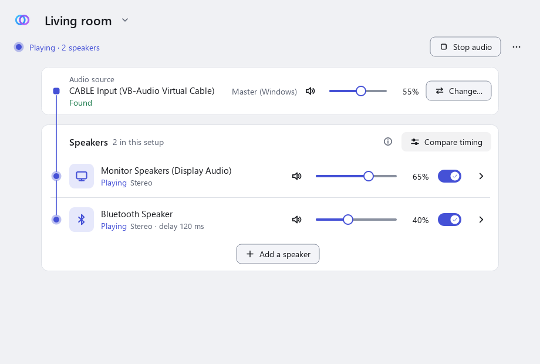
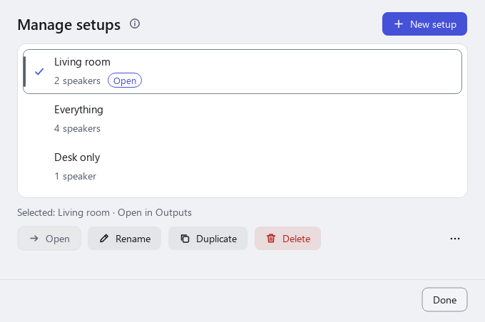

  

<h1 align="center">PlayNice</h1>

<strong>Play audio through multiple speakers at once on Windows 11.</strong>

> **Status:** PlayNice is in early testing. The first beta has not been published yet, so the
> [Releases page](https://github.com/tensorsofthewall/playnice-windows/releases) has no download until it is.

PlayNice sends the sound of your computer, or of one program, to several audio outputs at the same time: for
example a monitor, a USB headset and a Bluetooth speaker.

<picture>
  <source media="(prefers-color-scheme: dark)" srcset="assets/screenshots/outputs-dark.png">
  
</picture>

*The screenshots on this page use made-up device names.*

## What you can do

- Play audio on **several speakers together**.
- Use **Bluetooth and wired** outputs in the same setup.
- **Select an audio source**: the sound of Windows, or of one program, sent to a virtual cable.
- Save **speaker setups** and switch between them.
- Set **volume and mute** for each speaker. These change the speaker's volume in Windows.
- Choose **channels** for each speaker (stereo, left, right, mono or swapped sides).
- Adjust **timing by ear** with a delay for each speaker.
- **Start PlayNice at sign-in**, if you want it to.

<picture>
  <source media="(prefers-color-scheme: dark)" srcset="assets/screenshots/manage-setups-dark.png">
  
</picture>

## Get started

| | |
| --- | --- |
| **Download** | [Latest release](https://github.com/tensorsofthewall/playnice-windows/releases/latest) |
| **Install** | [Installation](docs/installation.md) |
| **First use** | [Getting started](docs/getting-started.md) |
| **Something wrong?** | [Troubleshooting](docs/troubleshooting.md) |
| **Report a problem** | [Open an issue](https://github.com/tensorsofthewall/playnice-windows/issues/new/choose) and read [Reporting a problem](docs/reporting-a-bug.md) first |
| **Suggest a feature** | [Feature request](https://github.com/tensorsofthewall/playnice-windows/issues/new/choose) |
| **Questions** | [FAQ](docs/faq.md) |

## VB-CABLE is a separate prerequisite

To send the sound of Windows (or of one program) to PlayNice, you need a virtual audio device. PlayNice works with
**VB-CABLE** from VB-Audio. It is a separate product, made and licensed by VB-Audio, and it is **not** included in or
installed by PlayNice. Get it only from the official site: <https://vb-audio.com/Cable/>.

## What to expect

PlayNice does not promise that speakers will be perfectly in step. Different devices, and Bluetooth in particular,
add different delays. You set a delay for each speaker by ear, and an option keeps speakers from drifting apart over
long sessions. PlayNice does not measure delay for you, does not promise that picture and sound will match in video,
and does not work with every audio device or every Bluetooth speaker. See [Troubleshooting](docs/troubleshooting.md).

PlayNice never changes your Windows default audio device for you.

## About this repository

PlayNice is **proprietary software**. This repository is for downloads, documentation and support. It does not
contain the program's source code and is not open source.

- [Security policy](SECURITY.md)
- [Third-party notices](THIRD-PARTY-NOTICES.md)
