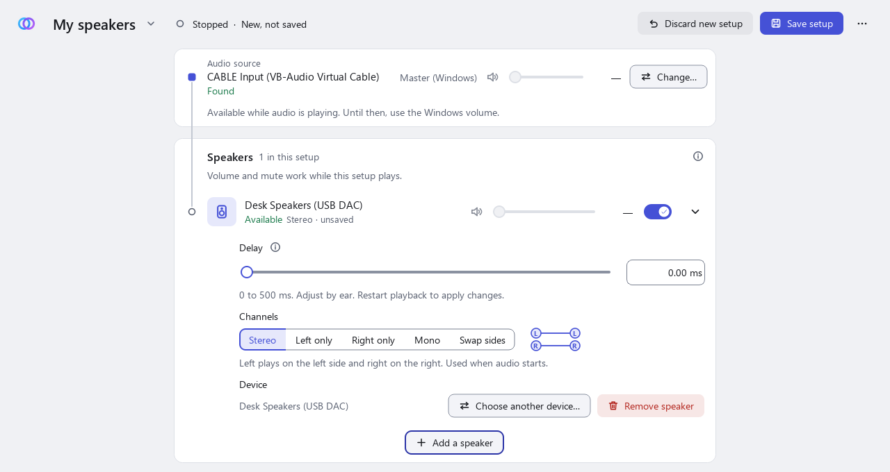

# Getting started

This page takes you from nothing installed to sound on two speakers at once. It assumes you have never used a virtual audio device. Allow about 30 minutes the first time, including one restart of Windows.

**The example used throughout:** sound from a web browser goes to a virtual cable (VB-CABLE), PlayNice picks it up there, and plays it on **a wired speaker and a Bluetooth speaker** together. Other programs, other speakers and other numbers of speakers work the same way.

## How it fits together

Windows normally sends a program's sound straight to one device. PlayNice cannot split that sound by itself, so it uses a middle step:

```
Browser  ->  CABLE Input  ->  PlayNice  ->  wired speaker
(Windows plays here)         (picks the sound up)  ->  Bluetooth speaker
```

- **VB-CABLE** is a virtual audio device made by a different company (VB-Audio). It is not part of PlayNice, and VB-Audio's own terms apply to it. It adds two entries to Windows: **CABLE Input** (an *output*, where programs play their sound) and **CABLE Output** (an *input*, which PlayNice does not use).
- Sound sent to CABLE Input is **not heard** by itself. You hear it only while PlayNice is playing it on your real speakers. That is why this guide has you get PlayNice ready *before* you send a program's sound to the cable.
- PlayNice never changes your Windows default playback device, and never changes which device a program uses. You make that choice yourself, in Step 9.

What you need: 64-bit Windows 11, a wired speaker (or headphones, or a monitor with speakers) and a Bluetooth speaker.

## 1. Download and install PlayNice

1. Open the [Releases page](https://github.com/tensorsofthewall/playnice-windows/releases) of this repository.
2. Download the installer, `PlayNice-<version>-Setup-x64.exe`, from the newest entry. While PlayNice is in beta, releases are marked **Pre-release**; that is expected.
   - If the list has no installer yet, no beta has been published and there is nothing to install. Check again later.
3. Check the file as described in [Installation](installation.md#download), then run it and choose **Install for me only**.
4. Leave **Start PlayNice** ticked on the last page, or open PlayNice later from the Start menu.

If Windows shows a warning about the installer, read [Windows warnings](installation.md#windows-warnings) first. Do not turn off any Windows protection to get past it.

The first time PlayNice opens it may say **The PlayNice controller is not running**. The controller is a small background program that holds your setups and runs the audio. Choose **Start controller**. You can leave PlayNice open on its first screen while you do Steps 2 to 4.

## 2. Download VB-CABLE from the official site

1. Open <https://vb-audio.com/Cable/> in your browser. Use this address only; do not download VB-CABLE from other sites.
2. Download the VB-CABLE driver pack (a ZIP file). Read VB-Audio's page for the licence and terms that apply to it.
3. When the download finishes, find the ZIP in your Downloads folder.

PlayNice does not download, install or update VB-CABLE for you.

## 3. Extract the ZIP

Windows cannot run the installer from inside a ZIP file.

1. Right-click the downloaded ZIP and choose **Extract All…**, then **Extract**.
2. Open the new folder. It contains several files, including setup programs for 32-bit and 64-bit Windows.

## 4. Install VB-CABLE as administrator

1. In the extracted folder, find the **64-bit** setup program (its name ends in `_x64`).
2. Right-click it and choose **Run as administrator**. Accept the Windows prompt.
3. Follow VB-Audio's installer (it offers an **Install Driver** button) and accept its prompts. Windows may ask whether to trust software from VB-Audio. Read the prompt; this installs a driver, and doing so is your decision. These steps describe VB-Audio's installer as documented by VB-Audio; PlayNice's own documentation has not run it for this page.
4. **Restart Windows** when the installer asks, or afterwards if it does not.

Do not use the 32-bit setup program on 64-bit Windows 11. If installing fails, follow VB-Audio's instructions or contact VB-Audio; PlayNice cannot repair their installer.

> *[Screenshot to be added: VB-CABLE's installer window. It has not been captured because installing VB-CABLE is a change to the computer that was not done for this page.]*

## 5. Check that Windows now lists the cable

After the restart:

1. Open **Settings > System > Sound**.
2. Under **Output**, look for **CABLE Input (VB-Audio Virtual Cable)**.
3. Under **Input**, look for **CABLE Output (VB-Audio Virtual Cable)**.

| Name | Kind | What it is for |
| --- | --- | --- |
| **CABLE Input** | Output (playback) | Where a program plays its sound. This is the one you point programs at, and the one PlayNice listens to. |
| **CABLE Output** | Input (recording) | The other end of the same cable. You do not use it with PlayNice. |

A simple way to remember it: **sound goes into CABLE Input**. You may also see an extra entry such as *CABLE In 16ch*; use **CABLE Input** unless PlayNice tells you otherwise.

Leave your normal speakers as the Windows default. Do **not** make CABLE Input the default device.

> *[Screenshot to be added: the Windows Sound settings page listing CABLE Input under Output and CABLE Output under Input. Windows shows your real device names there, so it has not been captured for this page.]*

## 6. Connect your speakers and check that Windows lists them

1. Plug in or switch on the wired speaker.
2. Pair the Bluetooth speaker: **Settings > Bluetooth & devices > Add device**, choose **Bluetooth**, put the speaker in pairing mode, and select it. Make sure it says **Connected**.
3. Back in **Settings > System > Sound**, check that both appear under **Output**, each marked as ready (not "Disabled" or "Disconnected").
4. Optionally open a speaker's entry and use its **Test** button to hear it once. Turn the volume down first.

PlayNice can only use speakers that Windows lists and that are switched on and connected. A Bluetooth speaker that has gone to sleep disappears from the list until it reconnects.

## 7. Create your first setup in PlayNice

A **setup** is a saved list of speakers that play together. You can have several, for example "Living room" and "Desk only".

1. Open PlayNice. If it says the controller is not running, choose **Start controller**.
2. The first screen is **Set up your speakers**. Under **1. Audio source**, it should say **Audio source: found** and **Ready: VB-CABLE "CABLE Input (VB-Audio Virtual Cable)"**.
   - If it says **not found**, install VB-CABLE (Steps 2 to 5) and choose **Check again**. You can still carry on and add speakers, but audio will not start until the cable is found.
3. Under **2. Name your setup**, type a name, for example `Living room`, and choose **Continue to speakers**.

Nothing is saved yet. PlayNice saves the setup in Step 8.

<picture>
  <source media="(prefers-color-scheme: dark)" srcset="../assets/screenshots/first-run-cable-found-dark.png">
  
</picture>

If the cable is not found, the screen instead says **Audio source: not found** and offers **Check again**:

<picture>
  <source media="(prefers-color-scheme: dark)" srcset="../assets/screenshots/first-run-cable-missing-dark.png">
  
</picture>

*These screenshots use made-up device names.*

## 8. Add the first speaker and save

1. On the setup page, check the **Audio source** card. It should show the **CABLE Input** entry with **Found**. If you ever need to change it, choose **Change…**, then pick the entry marked **VB-CABLE**.
2. Choose **Add a speaker**. A list of the playback devices Windows has appears.
3. Select your **wired speaker** and choose **OK**.
4. Choose **Save setup** at the top right.

PlayNice does not accept the cable itself as a speaker. If a device is listed as *unavailable* or *not available now*, switch it on or reconnect it, then use the refresh button in the list.

<picture>
  <source media="(prefers-color-scheme: dark)" srcset="../assets/screenshots/add-speaker-dark.png">
  
</picture>

<picture>
  <source media="(prefers-color-scheme: dark)" srcset="../assets/screenshots/first-speaker-dark.png">
  
</picture>

Saving does not start audio.

## 9. Start audio, then route one program to the cable

Order matters here: start PlayNice first, so that sound sent to the cable has somewhere to go.

1. In PlayNice, choose **Start audio**. The status becomes **Playing**.
2. Start something playing in your browser, for example a video. At this moment you may hear it on your normal speakers, because the browser is still using the Windows default device.
3. In Windows, open **Settings > System > Sound > Volume mixer**.
4. Find your browser in the list. For that browser, set the **Output** (the device it plays to) to **CABLE Input (VB-Audio Virtual Cable)**. If you do not see an output list, open the browser's entry (the small arrow on its row) first.
   - A program usually appears in the mixer only after it has played sound. Play something, then look again.
   - Some programs only move to the new device after you pause and resume, or restart them.
5. The browser's sound should now come from your **wired speaker**, through PlayNice, and no longer from the Windows default device.

> *[Screenshot to be added: the Windows Volume mixer with a browser's output set to CABLE Input. Windows shows the program list and devices of the person who captured it, so it has not been captured for this page.]*

**Check that it works:** you should hear the browser's sound on the wired speaker only. The Windows default device should be silent for that browser.

**If you hear nothing:** see [No sound from any speaker](troubleshooting.md#no-sound-from-any-speaker). The usual causes are a browser still pointed at another device, or PlayNice not yet playing.

**Only that one program goes to PlayNice.** Everything else on the computer keeps using the Windows default device, so you will keep hearing notifications and other programs normally.

## 10. Add the Bluetooth speaker

Adding a speaker to a setup that is playing changes the setup but not the running audio.

1. Choose **Add a speaker**, select the **Bluetooth speaker**, and choose **OK**.
2. Choose **Save changes**. The header says the changes are saved but not applied.
3. Choose **Restart to apply changes**. Audio stops for a moment and starts again with both speakers.

Both speakers should now play the browser's sound.

<picture>
  <source media="(prefers-color-scheme: dark)" srcset="../assets/screenshots/playing-two-speakers-dark.png">
  
</picture>

## 11. Adjust volume and timing

- **Volume.** Each speaker has a slider and a mute button. They change that device's volume and mute **in Windows**, so the same volume applies outside PlayNice and is not saved with the setup. They work while the setup is playing.
- **Master (Windows)** on the source card is the Windows volume of the cable itself. It also works while audio is playing.
- **Timing.** Different speakers take different amounts of time to play a sound, and Bluetooth is usually later than a wired speaker. If you hear an echo, delay the **earlier** speaker (usually the wired one) until the sounds line up. Open a speaker (the arrow on its row) to set its **Delay**, or choose **Compare timing** to see both delays together. You set this by ear; PlayNice does not measure it. Changes apply after you save and restart playback.
- **Channels.** In the same panel, choose **Stereo**, **Left only**, **Right only**, **Mono** or **Swap sides** for each speaker.

<picture>
  <source media="(prefers-color-scheme: dark)" srcset="../assets/screenshots/compare-timing-dark.png">
  
</picture>

Perfect alignment is not promised. See the [Settings guide](settings-guide.md#speaker-delay-and-compare-timing) for what delay can and cannot do.

## 12. Optional settings

Open the **...** menu at the top right and choose **Settings…**.

- **Keep PlayNice in the system tray when the window is closed** keeps a tray icon so you can reopen the window.
- **Start PlayNice at sign-in** starts PlayNice in the tray when you sign in to Windows. It is off until you turn it on.
- **Drift correction**, **Starvation recovery**, **Priming** and **Limit the level while playing** are explained in the [Settings guide](settings-guide.md).

> *[Screenshot to be added: the complete Settings window. It has not been captured yet; a safe capture needs a native Windows window with no personal information visible.]*

## 13. Go back to normal Windows audio

You can undo the routing at any time. PlayNice does not need to be involved.

1. In **Settings > System > Sound > Volume mixer**, set the browser's **Output** back to **Default** (or to the device you want).
2. In PlayNice, choose **Stop audio**. Closing the PlayNice window does **not** stop the audio; **Stop audio** does.
3. To end the background program too: **...** menu, **Settings…**, **Shut down controller…**.

If a program stays silent after you stop PlayNice, it is probably still pointed at CABLE Input. See [Windows audio is silent after I stop PlayNice](troubleshooting.md#windows-audio-is-silent-after-i-stop-playnice).

To remove VB-CABLE, use VB-Audio's own instructions. Uninstalling PlayNice does not remove it.

## Next steps

- [Settings guide](settings-guide.md): every setting, what it does and its defaults.
- [Troubleshooting](troubleshooting.md): what to check when something does not work.
- [Reporting a problem](reporting-a-bug.md).
