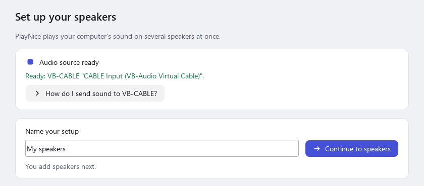
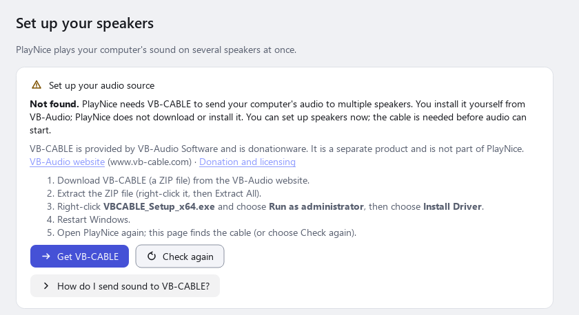
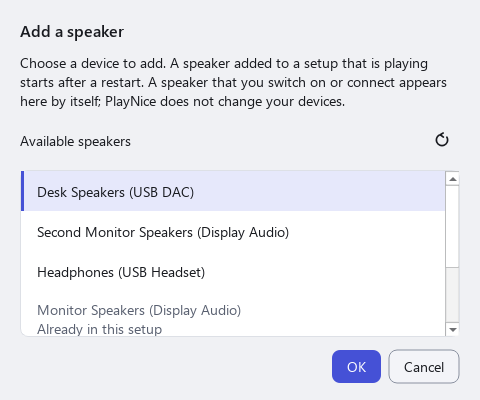
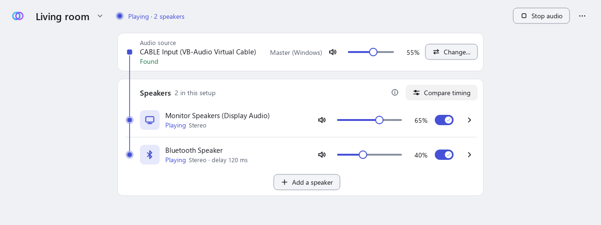
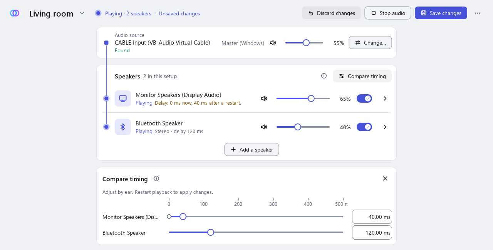

# Getting started

This page takes you from nothing installed to sound on two speakers at once. It assumes you have never used a virtual audio device. Allow about 30 minutes the first time, including one restart of Windows.

**The example used throughout:** sound from a web browser goes to a virtual cable (VB-CABLE), PlayNice picks it up there, and plays it on **a wired speaker and a Bluetooth speaker** together. Other programs, other speakers and other numbers of speakers work the same way.

## How it fits together

Windows normally sends a program's sound straight to one device. PlayNice cannot split that sound by itself, so it uses a middle step:

```
Browser  ->  CABLE Input  ->  PlayNice  ->  wired speaker
(Windows plays here)         (picks the sound up)  ->  Bluetooth speaker
```

- **VB-CABLE** is a virtual audio device made by a different company (VB-Audio Software) and is donationware. It is not part of PlayNice, and VB-Audio's own terms apply to it. You install it yourself from VB-Audio (Step 3); PlayNice does not install it for you. It adds two entries to Windows: **CABLE Input** (an *output*, where programs play their sound) and **CABLE Output** (an *input*, which PlayNice does not use). A simple way to remember it: **sound goes into CABLE Input**.
- Sound sent to CABLE Input is **not heard** by itself. You hear it only while PlayNice is playing it on your real speakers. That is why this guide has you start PlayNice *before* you send a program's sound to the cable.
- PlayNice never changes your Windows default playback device, and never changes which device a program uses. You make that choice yourself, in Step 8, in the Windows Volume Mixer.

What you need: 64-bit Windows 11, a wired speaker (or headphones, or a monitor with speakers) and a Bluetooth speaker.

## 1. Install PlayNice

1. Open the [Releases page](https://github.com/tensorsofthewall/playnice-windows/releases) of this repository.
2. Download the installer, `PlayNice-<version>-Setup-x64.exe`, from the newest entry. Earlier versions stay available, but use the newest.
3. Check the file as described in [Installation](installation.md#download), then run it. Keep **Install for all users (recommended)** (it goes into Program Files and Windows asks for permission, as for most programs) or choose **Install for me only**, which needs no administrator rights. You can choose another folder on the next page. See [Installation](installation.md#install) for the details.
4. Leave **Start PlayNice** ticked on the last page, or open PlayNice later from the Start menu.

If Windows shows a warning about the installer, read [Windows warnings](installation.md#windows-warnings) first, including the options if Smart App Control blocks it. Do not turn off Defender or SmartScreen to get past it.

## 2. Open PlayNice

PlayNice starts its own background program, the **controller**, when you open it. The controller holds your setups and runs the audio. If it cannot start, the window says **The PlayNice controller is not running** and offers **Start controller**.

## 3. Get VB-CABLE from VB-Audio

If PlayNice's first screen already says **Audio source ready**, or Windows already lists **CABLE Input**, skip to Step 5.

PlayNice does not install VB-CABLE. When it is missing, the **Audio source** card says **Set up your audio source**, says it was **Not found** and lists the steps; **Get VB-CABLE** opens VB-Audio's page in your browser. Setup showed the same steps on its **Virtual audio cable** page if the cable was missing when you installed PlayNice.

1. Open <https://vb-audio.com/Cable/> (use this address only) and download the driver pack ZIP.
2. Extract it (Windows cannot run the installer from inside a ZIP).
3. Right-click the **64-bit** setup program, `VBCABLE_Setup_x64.exe`, and choose **Run as administrator**. Windows asks for permission; only VB-Audio's setup gets administrator rights, and PlayNice keeps running as you.
4. In VB-Audio's window choose **Install Driver** and accept its prompts. Windows may ask whether to trust software from VB-Audio. Read the prompt; this installs a driver, and doing so is your decision.
5. Restart Windows (Step 4), then open PlayNice again.

About VB-CABLE: it is third-party **donationware** made by VB-Audio Software (<https://www.vb-cable.com>). It is independent of PlayNice and VB-Audio's own terms apply to it. If you find it useful, you can support VB-Audio on their [donation and licensing page](https://vb-audio.com/Services/licensing.htm). PlayNice does not include, download or run VB-Audio's installer. VB-Audio's driver is signed by VB-Audio and Microsoft; that is separate from PlayNice's own installer, which is currently **not** signed. If VB-Audio's setup fails, follow VB-Audio's instructions or contact VB-Audio; PlayNice cannot repair their installer.

> *These steps were followed by hand in a test virtual machine (the cable then reported as usable). PlayNice's own first screen has been checked with automated tests, and has not been tried on a clean computer that never had VB-CABLE. No screenshot of VB-Audio's window is shown here.*

## 4. Restart Windows

VB-CABLE needs Windows to restart before it works. If PlayNice is open while a restart is still pending, it says **Restart Windows to finish VB-CABLE**. PlayNice has no restart button and never restarts Windows by itself.

- Restart Windows yourself (save your work first), then open PlayNice again.
- If PlayNice still says the cable is waiting for a restart, choose **Check again**.

## 5. Check that Windows lists the cable

After the restart, open **Settings > System > Sound**. Under **Output** you should see **CABLE Input (VB-Audio Virtual Cable)**, and under **Input** **CABLE Output (VB-Audio Virtual Cable)**. You may also see an extra entry such as *CABLE In 16ch*; use **CABLE Input** unless PlayNice tells you otherwise.

| Name | Kind | What it is for |
| --- | --- | --- |
| **CABLE Input** | Output (playback) | Where a program plays its sound. This is the one you point programs at, and the one PlayNice listens to. |
| **CABLE Output** | Input (recording) | The other end of the same cable. You do not use it with PlayNice. |

Leave your normal speakers as the Windows default. Do **not** make CABLE Input the default device.

Then connect your speakers: plug in or switch on the wired speaker, and pair the Bluetooth speaker (**Settings > Bluetooth & devices > Add device**) until it says **Connected**. Both should appear under **Output**, not marked "Disabled" or "Disconnected". PlayNice can only use speakers that Windows lists and that are switched on and connected; a Bluetooth speaker that has gone to sleep disappears from the list until it reconnects.

## 6. Create the first setup, test the speaker and save

A **setup** is a saved list of speakers that play together. You can have several, for example "Living room" and "Desk only".

1. On PlayNice's first screen, check that the **Audio source** card says **Audio source ready** and **Ready: VB-CABLE "CABLE Input (VB-Audio Virtual Cable)"**. If it says **Set up your audio source**, get VB-CABLE (Steps 3 to 5) and choose **Check again**; you can still carry on, but audio will not start until the cable is found.
2. Under **Name your setup**, type a name, for example `Living room`, and choose **Continue to speakers**. Nothing is saved yet.
3. Choose **Add a speaker**, select your **wired speaker** in the list of playback devices Windows has, and choose **OK**. PlayNice does not accept the cable itself as a speaker. A device listed as *unavailable* needs to be switched on or reconnected; use the refresh button in the list.
4. **Test it.** Choose **Test** on the speaker's row. PlayNice plays a short, soft sound on that one speaker, so you can check it before anything else. It then says *Test sound sent to ... Did you hear it?*, a note that clears itself after about ten seconds (or with its X). That means **Windows accepted the sound; PlayNice cannot know whether you heard it**. If you heard nothing, see [No sound from one speaker](troubleshooting.md#no-sound-from-one-speaker). **Test** does not need the cable, and it never changes the speaker's Windows volume or mute: if the speaker is muted or at zero in Windows, PlayNice tells you instead. It is switched off while the playing setup uses that speaker.
5. Choose **Save setup** at the top right. Saving does not start audio.

<picture>
  <source media="(prefers-color-scheme: dark)" srcset="../assets/screenshots/first-run-cable-found-dark.png">
  
</picture>

If the cable is not found, the first screen instead says **Set up your audio source** and lists the steps and offers **Get VB-CABLE** and **Check again**:

<picture>
  <source media="(prefers-color-scheme: dark)" srcset="../assets/screenshots/first-run-cable-missing-dark.png">
  
</picture>

<picture>
  <source media="(prefers-color-scheme: dark)" srcset="../assets/screenshots/add-speaker-dark.png">
  
</picture>

*These screenshots use made-up device names.*

## 7. Start audio

Order matters: start PlayNice first, so that sound sent to the cable has somewhere to go. Choose **Start audio**. The status becomes **Playing**.

## 8. Send one program to the cable

After you save, a card called **Send audio to PlayNice** explains this last step. It says *PlayNice is running. Send audio to CABLE Input to hear it through your speakers.* until it hears sound from the cable, and then *Playing on 2 speakers.* (the number that are playing). The card is meant for newcomers: close it with its X once you know the way, and bring it back from the **...** menu if you want it again.

1. Start something playing in your browser, for example a video. You may still hear it on your normal speakers, because the browser is still using the Windows default device.
2. Open **Settings > System > Sound > Volume mixer**. The card's **Open Windows Volume Mixer** button opens it for you (it only opens the page; PlayNice does not change any setting in it).
3. Find your browser in the list and set its **Output** (the device it plays to) to **CABLE Input (VB-Audio Virtual Cable)**. A program usually appears in the mixer only after it has played sound, and some only move to the new device after you pause and resume, or restart them.
4. The browser's sound now comes from your **wired speaker**, through PlayNice, and no longer from the Windows default device.

**If you hear nothing:** choose **Can't hear audio?** above the speaker list. PlayNice lists what it can tell: whether VB-CABLE is installed, whether a speaker is missing, muted in Windows or failed, and whether it has heard any sound from the cable recently. Silence alone is not an error: a paused video looks the same. See also [No sound from any speaker](troubleshooting.md#no-sound-from-any-speaker).

**Only that one program goes to PlayNice.** Everything else keeps using the Windows default device, so notifications and other programs are heard normally. You can also make **CABLE Input** the Windows default output to send all sound through PlayNice; it is optional, and PlayNice never does it for you. Sound sent to CABLE Input cannot be heard while PlayNice is stopped, so point the program (or the default) back if you stop PlayNice.

## 9. Add the Bluetooth speaker

Adding or removing a speaker, switching one on or off, or changing the audio source changes the *membership* of the running setup, so it needs a restart of the audio.

1. Choose **Add a speaker**, select the **Bluetooth speaker**, and choose **OK**. Use **Test** on it too.
2. Choose **Save changes**. The header says the changes are saved but not applied.
3. Choose **Restart to apply changes**. Audio stops for a moment and starts again with both speakers.

<picture>
  <source media="(prefers-color-scheme: dark)" srcset="../assets/screenshots/playing-two-speakers-dark.png">
  
</picture>

## 10. Adjust channels and timing, then save and hear it

- **Volume.** Each speaker has a slider and a mute button. They change that device's volume and mute **in Windows**, so the same volume applies outside PlayNice and is not saved with the setup. They work while the setup is playing. **Master (Windows)** on the source card is the Windows volume of the cable itself.
- **Channels.** Open a speaker (the arrow on its row) and choose **Stereo**, **Left only**, **Right only**, **Mono** or **Swap sides**.
- **Timing.** Different speakers take different amounts of time to play a sound, and Bluetooth is usually later than a wired speaker. If you hear an echo, delay the **earlier** speaker (usually the wired one) until the sounds line up. Set its **Delay**, or choose **Compare timing** to see all delays together. You set this by ear; PlayNice does not measure it.
- **Save, and hear it.** Choose **Save**. Channel and delay changes are then applied to the playing audio **without a restart**. PlayNice shows *Applying…* and says **Applied to the running audio.** only after the audio has taken the change. A delay change is a short cross-fade, so it can be briefly audible. If it says *Saved, but not applied to running audio*, choose **Retry**.

<picture>
  <source media="(prefers-color-scheme: dark)" srcset="../assets/screenshots/compare-timing-dark.png">
  
</picture>

Perfect alignment is not promised. See the [Settings guide](settings-guide.md#speaker-delay-and-compare-timing) for what delay can and cannot do.

## 11. Quit, Stop and coming back

- **Closing the window** hides PlayNice in the system tray (if that option is on, the default) and **audio keeps playing**.
- **Stop audio** stops the sound but keeps PlayNice running. Opening PlayNice later does **not** start the sound again.
- **Quit PlayNice** (the **...** menu, the tray menu or Ctrl+Q) stops the sound and closes PlayNice completely. If sound was playing, the **next time you open PlayNice, it starts again by itself and plays that setup again** ("Resuming audio…"). If a speaker is not there at that moment, PlayNice does not substitute another one; it waits a while and then says it could not resume.
- **Shut down controller** (Settings) is a deliberate full stop: PlayNice does not start its controller by itself the next time; choose **Start controller**.
- **If a speaker disconnects** (a Bluetooth speaker switching off, a USB device unplugged) the others keep playing, PlayNice shows it as *reconnecting*, tries again for about two minutes, and the speaker rejoins by itself when it comes back. It does not replay what it missed, and it never uses a different device in its place.

The tray icon shows the state with a badge: a green play triangle (playing), a grey square (stopped), a blue clock (starting or stopping), an amber **!** (playing with a problem), a red **X** (failed). Hover over it for the same in words.

## 12. Optional settings

Open the **...** menu at the top right and choose **Settings…**. **Start PlayNice at sign-in** starts PlayNice in the tray when you sign in to Windows; it is off until you turn it on. **Drift correction**, **Starvation recovery**, **Priming** and **Limit the level while playing** are explained in the [Settings guide](settings-guide.md).

## 13. Go back to normal Windows audio

You can undo the routing at any time. In **Settings > System > Sound > Volume mixer**, set the browser's **Output** back to **Default**, and in PlayNice choose **Stop audio** (or **Quit PlayNice**). If a program stays silent after you stop PlayNice, it is probably still pointed at CABLE Input. See [Windows audio is silent after I stop PlayNice](troubleshooting.md#windows-audio-is-silent-after-i-stop-playnice).

VB-CABLE stays installed unless you remove it. PlayNice's uninstaller never removes it (see [Uninstall](installation.md#uninstall)); VB-Audio's website describes how to remove it.

## Next steps

- [Settings guide](settings-guide.md): every setting, what it does and its defaults.
- [Troubleshooting](troubleshooting.md): what to check when something does not work.
- [Reporting a problem](reporting-a-bug.md).
